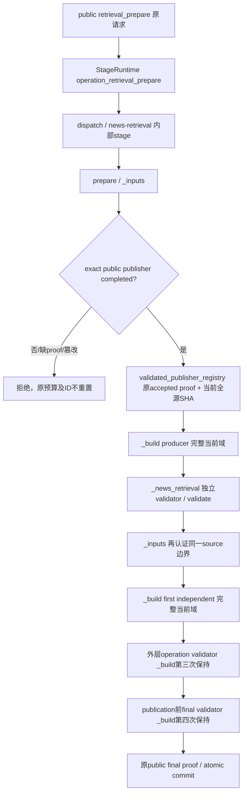

# 根据冻结输入输出定义的子链设计

本设计依据 `chain-contract-freeze.json` revision 1 及其三份定义文件。先冻结定义，再用此设计约束实现。此前代码为原型，需要逐项改为符合协议；原型测试不抵本设计的子链验收。

## 模块与责任

`scripts/chains/protocol.py` 只加载并核验冻结协议和科学定义的实际 SHA，生成协议控制上下文。实现身份覆盖所有子目录源码。它不处理金融数据，不授予科学资格。

`scripts/chains/contracts.py` 校验 DTO 类型、必填、阶段顺序、上游及账户绑定、完整分母与金额缺项表示。它接受明确对象，保持纯验证；它不读取数据库、网络或 `latest`，也不接受字面 `independent: true` 作为资格真实性。

八个生产模块分别为 `account.py`、`news_collection.py`、`news_assessment.py`、`fund_universe.py`、`fund_sources.py`、`model.py`、`recommendation.py`、`reporting.py`。每个模块接受调度控制上下文；账户模块的业务输入为空，其他模块仅接受完整上一 envelope。它们产出真实对象或明确的不足诊断，并返回原始公开操作的不可变引用。算法、消息、预算和字段不通过用户额外提示来补齐。

`scripts/chains/gates.py` 独立检查输入输出和实际来源、原 engine 验收以及业务后置条件。它仅从可信 gate 的实际完成操作、原验证尝试与原子提交证明取得资格；重读当前绑定和 CAS 字节，不从 producer 字面字段或下载计数推断资格。它将不合格结果标为不足，保留原数据及具体失败规则。

`scripts/chains/controller.py` 是唯一调度者，负责调用、校验、传递、封存、进度及最终目标。`common.py` 只承载明确绑定和重复基础操作，不另选最新的业务结果。

## 调度与传递

1. 读取并校验冻结协议，生成当前 chain_id。先运行账户模块，在同一读事务冻结本金、风险、现金、批次、订单、在途及计划事实。首次缺必要事实返回 `awaiting_user`；已知事实不重复询问。
2. 每次调用前，记录当前阶段及确切前驱 CAS 引用，写入 inflight。校验输入 schema、协议/实现、账户、前驱 hash 和本次 lineage，再传给对应模块。
3. 每次调用后，独立校验实际输出和原操作回执。DTO 校验失败、来源失败、科学不足和金融状态变化分别定位，不把技术错误改成观察成功。
4. 只有校验通过的产物才能封存。lineage_refs 由调度者从本次既有封存输出生成，包含所有更早 envelope 的 CAS，按原顺序传递；子链不得补读旧次结果。封存本步结果及独立校验后才开始下一步。
5. `processing_complete` 表示一次处理有真实输出或诊断；`stage_complete` 表示协议的业务后置条件实际满足。严格主链只推进合格业务结果。必要账户或 host 行业分析未完成时保持 pending；其他证据不足可以在明确 observation 交付分支传递已校验的 partial，原业务失败仍保留、目标仍为 `goal_unmet`。
6. 每个阶段前后核验第一步账户快照是否仍与实际金融记录一致。变化返回 stale snapshot，使用新链重新冻结，不混入新旧账户。
7. 恢复使用同 chain_id、前驱、公开 operation IDs、冻结窗口及累计尝试预算。新一次正常调用才使用新链和当前新闻窗口，并沿用已确认账户。
8. 最终同时输出可读结论、当前阶段、最后正确输入、失败边界、封存 chain_outputs 和实际目标证据。只有八步业务后置条件与科学/金融资格满足，才为 `goal_achieved`；观察结论仍为 `goal_unmet`。

## 针对已查明根因的设计

原主链把整段七天新闻机会发现放在同步正文准备的前置条件里，source timeout 和后续正文 budget 没有约束该前置任务。验证数据中一次 publisher 操作约 93 分钟；随后 analysis_start 约 16 分钟，仅重复打开和验证同一来源图。它们是已观察到的耗时边界，尚无逐函数 CPU 分解。

广域发现、检索、原文获取和行业解释作为 news 子链内明确任务记录，保留原窗口、完整机会分母及未处理前沿；工程任务可分批和恢复，不能缩短近期窗口或只选择几个新闻/行业求通过。每个任务的请求、来源成本和不可变产物单独记录，调度者能定位实际停留的边界。未证明范围充分时，新闻业务条件继续不足，不能因正文数量达到预算就通过。

新闻收集内部的范围审计使用事前封存计划和专用公开 `scope-assess` 来源评审回执，正式行业业务 `assess` 仍是后一步，避免循环依赖。宿主按当前计划和真实原文完成内部审计，再由独立验证器重建支持/反证、原文/事件覆盖和重大未解条件。全球覆盖未知、原 seed 下载闭合和本次研究域是否满足证据条件分别记录；研究充分性不能绑定恒为 false 的全球窗口穷尽标志，也不能改写原 seed 指标为 true。机器主题仅形成待核问题；有依据的有限非重大判断与未知分别保留，不能把全部机器主题先验当作重大经济事项。

对已经独立验证并原子完成的 publisher 操作，消费端复用原语义验收证明，仍核 request、input、current code、accepted attempt、commit proof 及实际 CAS SHA。新 publisher 产出仍执行独立原语义校验；账户、市场、模型和建议的金融/科学校验不走来源语义捷径。此修改针对重复 ZIP 语义重放，不声明已经消除首次广域网络耗时。

按照冻结快照设计检查真实数值分支时，发现原 `daily_review` 的市场对账会自动追加估值事件并更新账户 sequence。这会使新的模型、建议和调度快照护栏拒绝正常数值路径，属于重构必须解决的实质冲突；它不是此前 publisher 前置延迟的原因。研究路径改用独立可验证的只读市场估值及权益检查投影，实际现金、份额、本金、风险确认与原账本保持原事实。真实交易及到账继续由反馈确认。所有当前持仓、订单、在途对应的风险代码从原快照提取并传递；当前 H 与必要风险范围分别保留，不能把订单风险当新候选排除。

费用文本和 URL 编码修复属于后续来源边界，不能拿它们解释前置发现耗时。数据缺少严格历史/权益/费率/模型校准时，记录精确来源缺口，不继续改阈值、改日期或替换候选求通过。

## 行业来源工序的精确接线

本节先定义内部来源任务的输入输出，再实现适配器；不修改 revision 1 的三份冻结定义。查明的实际缺边是 `fund_sources` 没有封存行业基准合同，`model.calculate` 也没有向 `daily_review` 传递合同或已接受的 `industry_data_id`，使行业采集器总是收到空数组。空研究库的历史新闻、定义、基金关系及权益版本缺口仍独立存在；补工序不授予历史模型资格。

`chains/industry_sources.py` 负责从本次精确 `news_review`、`discovery` 及第一步账户引用创建内部来源任务。任务逐项保留原 `industry_theses` 的 `thesis_id` 与实际 `sector_id`，不把展示的 `industry_id=thesis_id` 当作源分类，不删除尚未取得主体资料的行业。真实没有行业分母时，记录空分母事实而不要求宿主制造行业。基金原身份的 `tracking_target`、`benchmark_description`、发行人原文和已披露分类只是查询线索；`disclosed-benchmark:hash` 不是官方指数代码，允许投资范围不是实际持仓证据。

内部宿主提交 `source_submission`，必需且仅有下列四个字段，另可带一个 `fee_inspections` 字段：

- `source_task_ref`：当前任务的原 CAS 引用，绑定当前 chain、第一步账户、原评审和 discovery；不能替换成旧任务。
- `benchmark_contracts`：已经取得并核实身份原文的实际合同数组，结构由 `industry_data._contract` 或 `asset_domains.validate_series_contract` 验证；不填示例代码、币种、单位或过去可得时间。
- `industry_dispositions`：每个原 thesis 恰好一项 `{thesis_id, sector_id, status, reason}`。`status` 为 `supported` 或 `unknown`；supported 必须由同实际 sector 和 thesis 关联的原合同支持，unknown 必须保留具体原因。合同不能暗中遗漏重大未知分母。
- `source_captures`：实际接受的公开 `source_capture` 精确 `{operation_id, result_ref}` 数组。每个合同 `identity_document_ref` 必须匹配这些原操作或已封存的精确合法绑定，不能只凭调用方布尔值、自洽 hash 或未认证文档获得资格。
- 可选 `fee_inspections`：实际接受的当前 chain 公开 `fee_inspect` 精确 `{operation_id, result_ref}` 数组。其 payload 使用现有 `schema_version=4, adapter=document_formats_v2, code, sources`，sources 来自真实天天基金、发行人、日历和结算原文，由 `fee_sources` 重提取。有效合同允许保留只影响部分动作的真实缺口；不手填费率、到账或可用性。

`fund_sources.prepare(..., control_context, source_submission=None)` 在任何固定 ID 的 research/market 封存前做来源提交预检，防止先用空合同完成 market 后再收到真实合同而改变同 ID 请求。错误提交保留内部 `awaiting_analysis` 及逐项诊断，允许宿主在同一任务修正未接受的提交；不封存错误为不可改的来源结果。首次缺源合同则封存 `source_task_ref` 和 `source_submission_template_ref` 并返回 `awaiting_analysis`，宿主负责读取原文和办理公开来源操作，用户不需要填写内部合同。全部原行业明确为 unknown 时可封存诚实观察输入，保持业务不足和目标 false；真实无行业则合法封存空合同，不凭空等待不存在的行业。

来源提交通过预检后，适配器封存 `industry_source_binding_ref`，内容保留原任务、提交、精确来源回执、实际合同引用、完整行业处理分母和缺口。`source_bundle` 扩展字段为 `source_task_ref, source_submission_template_ref, industry_source_binding_ref, industry_source_status, industry_source_required_actions`；这些是原必需字段之外的具体来源引用，不改变冻结协议。`industry_sources.validate_binding(root, plan, chain_id, engine_context, reference, account_ref=...)` 供来源独立门和模型消费端重新认证原公开操作、CAS、主体/经济含义及完整行业分母，不能把 producer 的 status 当资格证明。

内部任务与 binding 分别使用 `chain_id:industry-source-task`、`chain_id:industry-source-bind` 工程声明 journal。在实际租约内 `complete(writes=...)` 原子封存记录与完成回执，读取端核验原请求、CAS、完成状态及真实创建时刻；不使用 maintenance 绕过业务租约。错误提交的预检在 bind journal 的 begin 之前，不能因错误正文耗掉稳定输入身份。binding 的 sealed_at 保留该 journal 的真实 created_at，所有来源捕获必须不晚于它；这些声明本身不消耗来源或模型验证预算，也不授予科学资格。

模型阶段只读上一 source_bundle 的 binding，向公开 `daily_review` 传完全相同的真实 `benchmark_contracts`，现有 `prepare_sector_data`、ALFRED 面板与 `industry_binding.bind_numerical_data` 继续取得并独立校验价格及基金桥接。没有真实行业输入时明确保留原缺口，不默认空数组冒充完成。内部方法声明仍只是工程政策，来源校验不替代成熟训练、完整路径、选择隔离、独立校准、费用和现金资格。

在真实输入/输出与独立门串联的辅助正例中，进一步发现观察请求模板采用示例的 `comparison_groups` 顺序，而正常发现控制器采用实际已封存的另一顺序；公开 daily 的精确原政策校验正确拒绝混入示例。模型消费端无论是否取得 market 或方法 spec，都从本次已接受的 discovery operation 读取并传递确切 `universe_policy` 与 ID，不排序、不变更政策、不查询 latest。

当前 q=0.05、尾部至少 20 来源日期及 50% 选择/校准分割是事前登记的内部政策，而不是论文指定的唯一科学常数。由此才有校准至少 400 日期、半切联合 OOS 至少 799 日期的必要下界；还须计入成熟时间、训练、NAV 暖机、假日和缺口。时间隔离、来源版本诚实和防止选择偏差有理论依据；具体参数并无普适最优证明。本轮保留既有门槛，不因来源不足调整参数，不把日期依赖的 400 个原点称为独立样本。

## 子链测试与真实验收

每个子链先测试协议正例、实际不足结果、非法输入、引用篡改、跨链和账户变化；模型阶段还需确认没有真实计算时不声明 compared_codes/现金比较/拟合，建议阶段确认无独立资格不制造金额。测试须检验实际行为或独立推导的边界，不能仅镜像实现。

调度测试覆盖唯一顺序、确切输入传递、原子封存、失败定位、partial 观察与主目标区分、同 ID 恢复、预算守恒、新调用账户沿用及代码/协议变化拒绝。受控来源、合成历史和脚本检查均标辅助范围。

以上全部必要检查通过后，才冻结待验最新版包并正式安装，在全新空隔离目录以必要账户事实完成全现金与持仓的首次及再次正常调用。真实宿主结果作为唯一全链验收依据；发现失败后先定位子链，再修复和复验，最后重新清除旧验收数据干扰并进行真实四次调用。

## 已接受来源语义复用与原文主题索引

本节先定义性能改动的输入输出和独立证明，再实现；三份冻结定义保持不动。仅扩展已完成的 `retrieval_prepare` 与 `material_prepare` 来源消费路径，账户、行情、费用、模型、时效及建议资格仍执行原独立校验。消除重复整域主题语义解码，不省略每次边界的实际源字节 SHA256 核查，不宣称消除首次广域下载成本。

`scripts/news_membership.py` 的生产输入为本次 `material_prepare.payload`、确切 collection manifest/ref，以及当前 workflow 的已完成 retrieval request/result；不选择 latest。输出 CAS 使用 `original_material_query_membership_v1`，包含 `workflow_id, run_id, collection_id, collection_manifest_ref, retrieval_operation_id, retrieval_result_ref, original_domain_ref, opportunity_domain_ref, complement_ref, version_themes`。`version_themes` 是每个实际原始版本恰好一项的对象；值为该版本实际捕获的 requested/final URL 在完整 parsed_parts 中匹配到的原 themes，去重且确定排序。无匹配为 `[]`，原元数据空主题匹配保留 `[null]`；不同原文、别名或版本不得按机器主题或发布者混接。全部机会、失败文件和未处理补集仍通过原 CAS 保留。

`material_prepare` result 与 material index 均携带同一 `query_membership_ref`。首次 producer 全域计算；独立 `_original_materials`/`_material_result` 从确切来源重新全域推导并逐字段比较，索引纳入原公开操作 accepted-attempt、最终独立 proof 与原子 commit。自洽 hash、裸 CAS 或命名 validator 不构成已接受证明。

消费接口为 `news_membership.validated_memberships(material_operation_id, store, artifacts, *, collection_manifest_ref, retrieval_operation_id, retrieval_result_ref=None)`，返回 `{version_id: set(themes)}`。它认证本次已完成 material/request/result 与同一 retrieval 的原输入、accepted attempt、最终 commit、当前实现及实际 CAS；核索引头、全部版本分母和来源引用。新闻范围 gate 每次继续推导完整动态问题、原文支持、反证与重大未知，只用该索引替代整域 themes 解码，不能复用旧 `research_scope_sufficient` 布尔值。

`stage_validation` 对已完成 publisher、retrieval 和 material 复用原独立来源语义 proof。所有类型仍先执行 `_operation_core`，核 canonical request/result、原 input/value/proof、accepted-attempt/outcome、原子 workflow completion 和当前代码；来源 helper 再核真实 canonical operation_result 及类型绑定，私有 reference traversal 实际重读全部引用字节。未完成、新 producer 或显式 `reuse_completed=false` 均继续原独立语义执行。复用作用范围只为来源，`trade_ready` 保持 false。

必要辅助检查先覆盖原文/主题错配、requested/final 别名、同 URL 多版本、空主题、无匹配、完整补集、独立重建拒绝自封错误索引；再覆盖 completed 消费无整域语义重放但实际读源 SHA，篡改任何 CAS/请求/结果/输入/proof/accepted-attempt/commit/代码均拒绝，金融校验仍调用原 validator。这些工程结果不替代真实安装调用验收。

### 来源引用完整闭包的输入输出与认证顺序

只消除显式 themes 重建仍不足：原通用 `verify.references` 会反复解码整域 JSON 来发现嵌套引用。`material_prepare` 另生产 `source_reference_closure_ref`，其 CAS 使用 `source_reference_closure_v1`。输入 roots 为本 workflow 的确切 `publisher_result_ref, retrieval_result_ref, collection_manifest_ref, query_membership_ref, material_index_ref`；material index 继续包含全部 page/excluded refs，publisher wrapper 保留原 ZIP、目录、registry 和元数据依赖，retrieval 保留完整机会及补集。roots 不包含 material 自己的 core/result/final proof 或 inventory 本身，避免循环。

输出 `{schema_id, roots, references, scope}`；`references` 是完全按照原通用引用规则递归读取并解析每个 JSON 后得到的唯一逻辑 CAS 引用全集，按引用身份确定排序。带 chunks 的逻辑 CAS 由实际 CAS read 校验所有存储 chunk 和总体 SHA。首次 producer 创建，独立 material validator 从 canonical prior publisher/retrieval、确切 manifest/index 和当前 CAS 完整重建并精确比较 roots 与全集，证明包含所有原 ZIP、原始机会、未处理补集、原文及索引。inventory 进入真实 material accepted core、attempt 和最终原子 commit；它只证明封存来源引用结构，不证明新闻、行业、模型或交易资格。

消费接口为 `stage_validation.accepted_source_reference_checker(material_operation_id, store, artifacts)`。它每次新建私有 candidate walk，先读取 inventory CAS 并逐项实际读全集字节核 SHA/size；库存内源节点因此可省略重复 JSON 解码，库存外引用继续完整递归。candidate 尚不可信：先直接以它执行原 `_operation_core` 与 `_completed_planned_source_proof`，核真实 canonical material request/result、原输入和 accepted value、原 accepted attempt、最终 commit 与 current code，并核 roots 与确切 canonical prior source wrappers/index/ref 一致，核原独立 proof 包含完整闭包重建。全部符合后才暴露 walk；不能通过一般 validator 递归创建自身，不能凭 inventory 自声明或保存的 scope verdict 获准。

当前 publisher/retrieval/material 已完成消费仅从明确 workflow 的 `:materials` 身份选择已接受 inventory，材料尚未完成或来源没有该明确合法绑定时保持原通用引用校验。首次 material producer/independent 与显式完整语义审计不用库存替代首次重建。来源范围和主链引用核查可使用已认证 walk；金融/模型等库存外 CAS 仍递归校验，所有实际金融/时效/模型业务规则继续独立执行。每次调用重新实际读取来源字节，不跨调用沿用 byte memo。

辅助验收必须监测 completed 消费期原 parsed metadata leaf 不被任何 JSON decoder 解码，同时这些 leaf 与原 ZIP 的实际 SHA读取发生；删漏 inventory refs、换 roots、伪造新 inventory CAS/accepted result/commit 和实际 source leaf 篡改均拒绝，首次完整 producer/independent 仍重建闭包，金融 validator 仍执行。此设计处理重复解析根因，不扩展预测方法或改变冻结科学门槛。

## 数值方法沿用实际同类政策的输入输出

真实 source IO 已发现方法构造器写死示例 `comparison_groups` 顺序，而本次 discovery 原政策使用另一合法顺序；数值 daily 的 exact discovery/spec 校验因此拒绝。这里先定义接线，再修实现，不修改冻结三文件。

`build_automatic_strategy` 的来源输入必须包含本次 canonical discovery 的完整 `universe_policy`；生产调用继续由 `_method_source_inputs` 从原接受的 public market/discovery 取得，不选 latest。构造器先用 `fund_screen.validate_universe_policy` 校验实际 TT/CNY、份额类型、完整组要求及合法组规则，然后 deepcopy 原对象到输出 `spec.universe_policy`，保持字段和值及列表顺序精确相同，不从示例、默认政策或排序后的集合补造。确实缺少政策时返回明确 `automatic_strategy_needs_source` 和补源动作，不生成 numeric spec；非法政策拒绝。

旧 frozen epoch 的 `spec.universe_policy` 与本次实际政策不同时，不能改写旧 epoch 或仅更新输出为原 epoch。沿既有可求和 global error budget 登记下一 epoch，保留单调 epoch_number、原 parent_epoch_hash、原已用预算与未来剩余额度。政策未变时按原复用条件沿用该 immutable policy；源政策缺失或非法不能借旧 frozen spec 补齐。

辅助 fixture 明确声明 synthetic discovery policy，只验证 IO 和预算恒等式，不认证来源已知或投资资格。检查覆盖另一合法列表顺序的精确保留及无输入共享、缺源不 fallback、非法政策拒绝、政策变化登记新可求和 epoch且旧 spec/hash不变，以及旧无剩余预算的 epoch不能因政策变化取得新全额误差额度。真实 scientific qualification 和当前资金逻辑继续走原独立门。

## 大规模宿主内部提交的运输输入输出

实际广域检索产生约 16,060/16,064 个 metadata 问题；原 scope 模板每个空 review 的最小 compact JSON 为 283 bytes，仅数组即超过 4.56 MB。`_questions` 仍保留全部问题，不能为了适配原 1 MiB `read_object` 裁成 192 条。这里先定义下一候选的运输接口；当前安装版与真实验收库不改，冻结业务定义三文件保持不动。

新增 `scripts/chain_inputs.py` 专门服务 `scope_audit` 和 `source_evidence`。完整业务对象保持原 3 keys 或原行业来源 4 keys 加可选 fees；控制字段不进入业务对象。generic `read_object` 与正常金融/用户文件的 1 MiB 限制不扩大。小完整业务文件仍按原严格 JSON 读取，大内部对象通过小引用容器传递。

引用容器必需且仅有 `schema_id: investment_internal_chain_input_ref_v1, purpose, data_root, plan, chain_id, account_ref, binding_ref, input_ref`。`purpose` 仅允许 `scope_audit | source_evidence`；binding_ref 是本次确切 scope_plan_ref 或 source_task_ref。唯一对象根为实际 `plan_path(root, plan)`，不能根据容器父目录、外部路径或 URL 解引用。严格核本次 pending 阶段、root/plan/chain/首步账户及原计划/任务绑定后，使用 `Artifacts.read` 重核全部 chunks 与完整 SHA/size，再读完整原业务 JSON并校验全部分母；引用不是资格或来源证明。

公开入口 `input-stage --plan P --chain-id C --input-kind scope_audit|source_evidence --input 原内部JSON --output 小引用文件` 由同计划 command_gate 串行保护。原文件须为正规非 symlink，专用 reader 保留完整 JSON而不受 generic 1 MiB 限制；预检核全部原问题/行业恰好一次、所有 claim/capture/binding 引用、原 native 结构与原文谓词。无分析的真实完整模板只能搬运为 pending_analysis/pending_evidence，qualified 与 investment_goal_achieved 始终 false；非法引用、删重分母及错绑定拒绝。预检错误不封任何业务 request ID，不重置或消耗科学尝试，不改金融记录。

成功仅存完整 CAS（默认 16 MiB storage chunks）并写小容器。随后 `chain --chain-id C --scope-audit 小容器` 或 `--source-evidence 小容器` 解回同一完整业务对象，原 seal 前 preflight、独立 gate、账户及时效检查仍重新执行。输入过大不能截断或只接受 prefix；运输大小不能成为新闻、行业或基金覆盖限制。宿主办理所有内部文件与分母工作，用户不填 schema、模型或来源名单。

辅助检查采用实际大域原模板测 bytes与全部 IDs：raw generic reader 应拒绝 >1 MiB，专用 staging/loader 保留完整对象；空模板不获分析/科学资格。还核 source evidence 同协议、错 root/plan/chain/account/binding/purpose、删重分母、伪原文/capture、chunk/hash/size 篡改及失败不封 ID/不改预算/不动账户。新候选正式安装与新的空隔离首次/再次仍是最终验收；此运输工程检查不替代真实投资目标。

## .13 检索全域重复计算的精确等价修复

本节先定义输入、输出及文件级逻辑，再修改下一仓库候选；installed `.13`、运行数据及native prompt保持原版本。只读真实证据见 `runtime/retrieval-stage-audit-0629874038724ed1925d38efc9e806c3/REPORT.md`：cash/holdings生产约8分01/7分46，holdings内部首次validator另耗11分53；两owner在10秒内各耗约10秒CPU。原已知URL域约144万/140万，主题问题16064/16060，每次 `_build` 实际35361817/34531798次row×theme访问；不是只处理192个传输候选。producer、内部validator、外层operation validator、publication前final validator共四次；最后一次由 `pipeline.run` 再次调用 `_review_package`，不包含在最初只追到outer stage的三次估计里，独立erratum保留该更正。这些是实测工作量与调用事实，具体每个热点提速仍需下一候选验证。

输入不变：本次确切workflow/publisher_discovery ID、已完成public publisher的canonical request/result、原accepted input/value/attempt/outcome/final atomic commit/current代码身份、当前全部源CAS，以及同一GDELT窗口、registry、完整parsed_parts、原缺失文件和失败/排除行。输出 `_build` 的原结构、值、列表顺序、CAS字节、rank/heap tie规则、192工程预算、全部原机会、16000问题、补集与科学false标志均必须exact equal；不得缩7天、加主题白名单、改变sort key或删除未知。



`_inputs`复用的是旧publisher已经独立接受的语义验收，并重新读实际全部源SHA、原request/input/acceptedattempt/commit/currentcode，不重复旧ZIP语义。retrieval新产物的第一次独立全域 `_build` 重建仍执行。既有 `replay_originals`关键字保留调用兼容；验证回执明确记录实际publisher语义没有再次重放及已认证源字节，不把旧布尔值当事实或金融资格。显式publisher完整语义审计仍使用现有 `validate_operation_result(...reuse_completed=False)`，本轮不修改该路径。外层第三/第四次 `_build` 的accepted-stage复用另做设计，本次不静默省略。

文件级伪代码如下，按设计→生产改动→对应测试执行；其他生产文件不在本次ownership内。

```text
scripts/news_retrieval.py
  _inputs(payload, store, artifacts, replay_originals):
    keep exact workflow and canonical publisher request/result comparisons
    registry = stage_validation.validated_publisher_registry(exact discovery_id,
                                                           store, artifacts)
    keep exact canonical GDELT/result/window/coverage comparison
    return original publisher, authenticated registry, original GDELT

  _build(...):
    retain all original rows, URL flags, file states and query counters
    theme_tasks = invocation-local map keyed by original theme (including None)
    query_task(theme):
      if theme already mapped: return its existing task
      compute original fingerprint and original mechanism regex exactly once
      create original task data, counters, proposal maps and heap once
      record task under both original query_id and theme; preserve first order
    candidate = any(cached original mechanism hint for original row themes)
    keep _propose/rank/heap/selection/sort/budget expressions unchanged
    registry_hash = fingerprint(the exact authenticated registry) once per call
    use registry_hash at original three output fields
    return unchanged original complete-domain result and CAS objects

  validate(...):
    keep original full _build and reference/result exact comparison
    publish truthful source-authentication/replay metadata, no scientific true

tests/test_news_retrieval.py and auxiliary archived routing oracle
  pure routing tests invoke _build without claiming fake Store is public proof
  compare original .13 _build and new _build output + every emitted CAS byte
  cover None/non-web/duplicate rows/rank ties/>192 sources/unknown files
  add scale case with 16000 questions and repeated row-theme work
  assert theme-only fingerprint/regex work is once per distinct theme
  still assert complete row/URL/query/complement counts and no qualification

tests/test_operation_validation_reuse.py
  use actual public publisher pipeline under controlled transport
  retrieval _inputs consumes accepted source proof; forbid old parse/validate
  observe current raw ZIP and other source SHA reads; own _build still repeats
  reject producer-only/uncompleted/missingcommit/current code/byte/input tamper
```

原纯路由fixture只能验证算法和字段，不能伪装成public qualification；真实来源真实性正负例必须来自actualcanonical producer/validator/attempt/commit，不能mock producer结果或gate verdict。大规模辅助比较只证明新旧相同输入的算法与CAS等价、热点调用次数减少，不是新真实主验收或投资资格。使用目标case、新immutable源码/安装及新的真实轮次量实效，旧`.13` source_hash及失败/等待证据完整保留，不以静态次数估算宣称已修复真实时延。

### 正文后续采集的事前预算范围声明

本段是下一候选的有意scope语义revision，在新retrieval创建之前声明；不回填或修改任何`.13` frozen resource_plan、request、已消耗cost或原first窗口。真实缺边是初始原网页取得后，其原字节中实际派生的原文/父文档传输任务没有沿同一来源预算执行范围闭合；来源适配器另行由对应owner实现，不在本文件增加任意URL入口。

输入仍为确切本次publisher与完整机会域；`_build.resource_plan`输出唯一有意变化是 `budget_scope="all_initial_and_source_derived_actual_source_attempts_including_failures_and_producer_retries"`。该新值明确覆盖原initial、被实际原parent捕获与parser支持的derived requests、所有失败及producer retries。`max_source_requests, max_total_bytes, max_total_elapsed_seconds`及原计算公式完全沿用；spent/pending reservations沿原source journal累计，不为derived另开新全额、不重置时钟或历史尝试。

derived task必须有同source合法原parent capture/manifest/parser提取依据，继续满足原registered host/path/redirect/linked-parent条件。它只能扩展原初始问题的真实取材任务，不插入调用方任意URL，不替换原16k查询、既有原URL、失败文件或未处理补集；预算不足保留unknown与真实原因，不能借本段授scope充分性或科学资格。

等价测试以不可改的原`.13`算法为基线，先分别严格核原budget_scope与新值，再只把基线这一字段投影为预登记新值比较。其余所有字段、数值上限、原排序、领域计数及emitted domain/query/selection/complement CAS必须exact equal；顶层core/hash因该一个字段而变化属于事前声明revision，不能把其他差异一起归一化。旧原报告、原SHA和旧native仍保留，不用新scope解释或篡改旧记录。

```text
news_retrieval._build.resource_plan:
  keep source_budget = official_requests * original_retry_allowance + 192
  keep max_requests / max_bytes / max_elapsed original values
  only declare the new initial_and_source_derived_actual_attempts scope string
  no derived URL insertion and no additional source execution in this module

test_news_retrieval original-reference comparison:
  assert original .13 scope is the archived exact old literal
  assert candidate scope is the preregistered exact new literal
  project only that old resource_plan.budget_scope field
  compare all remaining result fields and emitted CAS references/content equal
```

## 新闻 registry 的 phase-local 精确复用 API

实现前已审查的实测/生命周期设计见独立 `runtime/child-news-acceptance-audit-7271dee0848d41ae88f9359df49ceb33/REGISTRY-PHASE-DESIGN.md`。ordinary child实际依赖165/170MB registry和当前网页，不依赖每次检索_build或3.9GB GKG图；本次只消除同一独立phase内反复registry read/decode/fingerprint，不扩大普通child的源图、预算或资格范围。`.14 b77`不可变副本、installed `.13`及live data保持原源码。

新模块 `registry_context.py` 的明确接口如下：

- `registry_phase(store, artifacts, *, inputs=None, fresh=True)`：创建/结束本次private context；从冻结inputs中的明确run_id/analysis_run_id预绑定真实Store.analysis_run的registry ref/hash，方便其后的引用遍历。unknown run仍由原run_policy拒绝，不能由caller registry或accepted bool补齐。`fresh=True`总建立新边界；`fresh=False`只在同一个Artifacts实例的现有phase内嵌套使用，没有现有phase时仍新建。
- `read_registry(run, store, artifacts)`：核run等于当前authoritative原记录，读取当前精确CAS并校验size/chunks/总SHA；本phase只decode一次并验证原canonical fingerprint。private parsed基准从不交给callee，每次返回detached普通dict/list；不可变字符串可安全共享。无active phase按原read_json工作，不能global缓存。
- `registry_fingerprint(value)`：仅在value与本phaseprivate原值**完整、类型敏感的JSON内容相等**时返回合法private scalar fingerprint；必须区分bool/int/float、嵌套list顺序和float signed zero（IEEE字节精确比较）；非finite没有缓存资格，dict两侧keys必须都是exact str，不能用Python普通dict相等（False==0等）。任何mutation都回到普通fingerprint计算，后续原expected hash校验可拒绝。不能按objectid、字典identity或旧boolean缓存可变view的hash。
- `checked_registry_reference(reference, artifacts, walk)`：只认本phase从authoritative run预绑定的exact ref；实际首次SHA/decode及全部嵌套CAS引用仍验证；私有内部遍历只向walk交detached小CAS ref，不暴露private registry dict/list。这个phase内已核的同一registry省重复decode，库存外refs继续原walk。每个新phase重新读当前源字节，publication guard亦是新phase。

`StageRuntime` producer、inner validator（含cache revalidation）、outer operation validator分别 `fresh=True`；`pipeline._review_package`在其既有validator phase内 `fresh=False`，publication前独立调用没有现有context，故建立新phase。`pipeline` commit guard和 completed-result consumer retry每次 `fresh=True`；公开 `stage_validation.validate_operation_result` 每次fresh=True新建（包括在其他producer/operation内部调用）；只有pipeline已经显式建立的同一验证边界调用内部 `_validate_operation_result` 全语义实现，不再套第二个context。跨operation或公开call绝不共用旧byte/boolean。嵌套StageRuntime必须restore外层token，不能把producer的private对象交给validator。返回产物、实际current CAS验证、三次producer/三个final rounds、原文重新提取、完整分母、pending、时点以及全部金融validator照常执行。

```mermaid
sequenceDiagram
    participant Runtime as StageRuntime
    participant Context as registry_context
    participant News as news / source helpers
    participant CAS as Artifacts
    Runtime->>Context: producer NEW phase, frozen inputs/run
    News->>Context: read_registry exact authoritative ref
    Context->>CAS: actual read SHA/size + one decode/fingerprint
    Context-->>News: detached dict/list views
    Runtime->>Context: close producer phase
    Runtime->>Context: validator NEW phase
    Context->>CAS: actual current read again
    News->>Context: content-equal view -> private scalar hash
    Runtime->>Context: close validator phase
    Runtime->>Context: outer/final/postaccepted each NEW boundary
    Context->>CAS: actual current SHA again; no old byte verdict
```

文件级实现与验收逻辑：

```text
registry_context.py:
  ContextVar holds only active phase; fresh entry always new, exit reset token
  each exact authoritative ref has private parsed original + verified scalar
  actual CAS read and canonical original fingerprint on first phase use
  return deep detached containers; never expose private original
  reuse fingerprint only after complete value equality, else normal hash
  registry ref walker validates nested refs once within phase; others recurse

validation_runtime.py:
  producer(attempt) under fresh phase using frozen binding inputs
  validator(value, inputs) under different fresh phase, preserving mutation check

pipeline.py / stage_validation.py:
  _review_package establishes/uses its own validator phase and calls full private implementation
  public operation validator always starts NEW, even nested across operations
  final publication guard and completed consumer each start fresh phase
  ordinary source and all financial OPERATION_VALIDATORS still execute

news.py / verify.py:
  run_policy uses authoritative registry reader and original policy predicates
  registry hash sites use content-proven private scalar, no objectid memo
  reference walker consults exact authoritative phase registry only

new tests:
  data/source/full URL denominator/hash equivalence and detached mutations
  actual SHA at producer/inner/outer/final/postaccepted independently
  no crosscall cache; CAS tamper between boundaries rejected
  mutated callee view not granted original fingerprint; nested refs still checked
  controlled 170MB registry-shape benchmark records decode/hash/read counts,
    marks auxiliary scope and makes no real-install speed or finance claim
```

本次不运行工作树native fixtures；新source稳定后由root统一immutable冻结验证。`.14`已绿色baseline独立保留，只有下一候选真实验证才能决定性能修复是否有效。

### 原选择采集到原文跟进的子工序

先定义 IO，再实现下一候选；正式 `.13` 的已冻结数据和调用保持原状。initial acquisition 输入本 workflow 的已接受 retrieval 原选择、source/run/window 和原工程预算，输出真实公开 child 的 exact request/result/manifest refs、parent raw captures 与完整 pending。来源计划输入这些实际 bytes 和原 source rule，重解析原 links/listing_links，输出完整派生域、真实 parent 身份、事前 CAS/工程 journal seal 和未知补集。唯一 scheduler 串行按 source 轮询，输入封存的 exact task 与同一累计剩余预算，输出公开 news_collect 的 actual body/lead/unavailable/partial；列表成功不能替代正文。PDF 在同 child 中先真实重抓官方父文，再读附件。

aggregate 只增加可选 `derived_source_tasks_ref`。它保存完整 initial receipts、每个事前 task/ref 与实际 child refs、全部 pending；stdout 只给小引用。`workflow_news.validate_followup_scope(payload, run, registry, store, artifacts)` 独立核实际父 raw bytes、原 accepted attempt、原源/窗口、事前 seal 不晚于 child 创建、精确请求、所有成本和完整补集，返回合法 `{collection_id: {source_id: requested_urls}}`。engine `scripts/news_scope.py` 仅据此接受原 planned URLs 之外的合法派生项，原来源/正文校验和 selection/complement 不变。

新 retrieval 事前声明 `all_initial_and_source_derived_actual_source_attempts_including_failures_and_producer_retries`；沿原全部 max_* 数值，只用原实际剩余 allowance。原 `.13` initial-only scope 不回填、不重解释。三轮三尝试、失败、中断都由原 `_cost` 累计，重启不重置；源累计唯一 listing 页数不随新 shard 重置。任务先预检，再 `begin -> lease -> complete(writes=...)` 原子 seal，再执行公开采集。没有实际 parent、未注册路径、时点不成立、循环已尝试、页数或预算不足都保留完整 pending/unknown，不缩到固定 agency/主题/基金，也不宣称全球或窗口穷尽。

辅助验证覆盖原列表 bytes→真实注册文章 URL→公开正文 CAS→独立 aggregate、CSRC API→正文、PDF 双请求、预算/重启、陌生 URL/假 parent/事后 seal/换 source/漏补集。最终仍以新 immutable 候选官方安装后的隔离最小首次和再次 native 调用验收。
