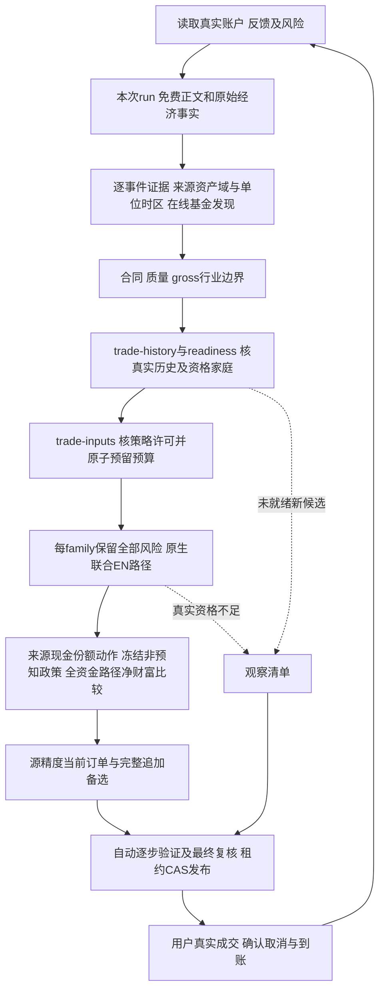

# 统一日常决策与金融记录

入口 scripts/investment.py，schema4，插件0.1.12。先读[执行契约](execution-contract.md)。一次用户调用由宿主连续编排，所有请求JSON由宿主生成。

已确认[方案2严格历史版本](strict-history.md)。每次完成来源与研究链；缺成熟版本/独立校准时交付观察，不重新问方法选择，不回填今天资料为过去可知。不假定等待固定天数即可取得资格；以实际readiness和完整路径校验为准。

先读取status并顺序确认用户已经提供的账户、风险与计划事实；这些公开写操作全部结束后，才启动长采集。终端返回会话ID时持续等待，不中断父shell再启动其他同计划写操作。

随后 `prepare --root <root> --plan <plan>` 自动执行status、publisher_discover、retrieval_prepare、analysis_start及经济检索计划的分批news_collect，汇总为本次原文assessment_material。权威目录与完整近期GDELT文件域只证明机会发现范围，机器主题不作事实；须逐原文评审。完整原机会账本与经济问题取材计划均封存；每批URL与版本化源请求预算只是工程限制，未选/未抓/模糊项仍进入canonical partial收据，全球及经济相关新闻分母未知保持未知。检索计划不能决定新闻事实、行业收益或交易资格，同类基金完整比较范围不随取材收缩。详见[检索依据](news-retrieval.md)。默认随机workflow_id确保再次用户调用重新采集；`--request-id`仅用于同次中断恢复。原schema4操作执行方式是 `run --root <root> --plan <plan> --request <request.json>`。prepare尚未做经济解释或基金优选，不是最终结果，宿主必须继续评审和报告。

内部绑定助手依实际Store生成请求，prepare同时返回request_templates；`requests --root <root> --plan <plan>`可重新读取本计划最新prepared的模板。宿主只写分析正文对象（claims/events/industry_theses，可含economic_observations），通过`assess --analysis <正文文件> --root <root> --plan <plan>`提交；run_id、collection_id、request_id与冻结policy由助手绑定，不手抄或根据manifest扩大来源。`--workflow-id`仅在同次明确恢复时指定，默认取本计划最新prepared；最新采集未完成不能自动退回上次结果。

assess提交前纯结构预审逐个检查观测、事件与sector/thesis引用。analysis_preflight_failed返回精确diagnostics，尚未创建正式operation或消耗三次预算；宿主据原文修正草稿归属，不删观测、添加无证据事实或缩小未知来取得通过。`assess --preview`仅生成已绑定请求及结构诊断，不等于已核事实、assessed或模型资格；正式提交仍经过原引文/单位/期间/时间/语义与最终验收。

`report --root <root> --plan <plan>`自动绑定本次非空assessment与原news_policy，并从同次最新完成的market_prepare调用method_prepare，依据原始NAV、完整原候选、真实账户和版本化方法自动构造策略。全现金基准为真实现金，已有持仓基准从已核当前净值计算；只使用已确认追加，未提供时只有零追加。方法登记仅为工程声明，实际数值、历史时点、费用和独立校准仍须原pipeline验收；缺来源返回明确待补证，不能问用户填写算法。`report --preview`只读诊断；内部原文industry_data_id、benchmark_contracts等可用`--inputs`传递。显式不同spec.news拒绝。尚无assessment时只作本次原文/账户观察，不能冒称完整链通过。

本次 `discover` 与 `research` 完成后，调用 `market --preview` 查看绑定及原始缺口，继续取得真实 `fee_inspect` 合同，再用 `market` 提交本次公开市场准备；缺项返回 `market_not_ready`/`needs_source`，不能补造。`requests`提供同次市场模板，`report`沿用最新已完成的完整发现结果，不重新执行单批发现。

本次基金发现完成后，内部`research --root <root> --plan <plan>`从实际Store选择同一已评review精确hash对应的最新已完成公开discovery，不手填discovery ID或猜lookback。默认lookback=120个原NAV区间、horizons=[30]个日历日、timeout=20秒，end为本次run开始日期（上海）的前一日，start=0001-01-01只表示请求所有实际存在的源观察，不表示基金出生日期或过去已知时间；真实模型窗由原观察构造，避免730日窗无法满足原尾部校准。工程取材/标签设置不证明参数最优，不是用户持有期，也不授予PIT。当前同次已冻结模型context存在时沿用其评价H，不自动声明模型。原型`requests`同时返回research请求及范围说明；`research --preview`不执行采集。明确参数可通过宿主的`--parameters <内部取材参数文件>`给出，仅允许start/end/lookback/horizons/timeout；先检查ISO日期及非未来范围、lookback整数≥120、唯一非空整数H∈[1,730]、timeout∈[1,30]，非法参数返回research_preflight_failed而不创建正式operation或消耗三次预算。

取材助手使用verified_identity_subset_v1：从原discovery的真实identity_snapshot原字节重建CNY及off_exchange_nav身份。取材库存为原金融codes、原group内有原身份依据的成员、全部持仓/订单/在途H的并集；金融codes为空仍可为合法原组主体积累资料，不改变金融准入。源未就绪的新候选只不参与本次取材，原codes、完整group、coverage和ref/hash完整保留；未采不代表不可买或已完成最优比较。源未明的真实H不可删除，返回needs_source和current_risk_unknown，继续观察而不创建研究ready。原pipeline生产和独立validator再次重建该源范围；实际采集codes执行完整来源与原120区间门槛，不接收宿主codes或verified旗标，也不把身份缺口改称样本成熟缺口。后续基金/金融候选范围、完整组和统计资格保持原合同，源范围通过不能代替模型资格。

仅该源取材模式可封存合法响应中两组NAV数组为空或声明窗口没有真实观测的情况：原主体、数组格式/时序/值/累计关系仍须独立重核，实际响应与行动资料保留，空数值表明确market_source_unavailable并继续其他主体采集。非空但不足120区间仍是insufficient_history；不编净值、不降门槛、不将资料不可得当参数错误。无价H不能计算当前权益或证明持仓安全，原H及风险缺口保留。普通金融研究模式继续拒绝空观测。

同一root/plan的公开操作必须等待前一项完成后再提交下一项，包括不同基金的source_capture/fee_inspect。它们共享数据库状态及最终发布围栏，不能因URL不同视为独立写任务；不得在fund_discover运行期间并发启动其他同计划操作，或用线程池/子代理并发写库。只读原文查看可并行。保留真实并发冲突及次数，不放宽CAS或通过更换请求ID突破失败预算。

```json
{"schema_version":4,"request_id":"example-status-1","operation":"status","payload":{}}
```

| 意图 | operation |
|---|---|
| 实际账户/首次缺项/风险/计划 | status |
| 确认本金与账户、风险版本/临时窗口、事实修订后对账 | profile_initialize、risk_update、capital_reconcile |
| 保存固定TT/CNY及用户明确给出的额外品类/限额与计划版本 | plan_update |
| 外部入金/出金准备、确认和追加修订 | cashflow_prepare、cashflow_confirm、cashflow_correct |
| 实际成交、取消、权益和到账 | feedback |
| 原始机构目录与全窗口新闻机会域 | publisher_discover |
| 权威本次run与新闻发布截点 | analysis_start |
| 原市场/账户绑定的自动方法与持续误差预算 | method_prepare |
| 原文采集与经济事实/研究解释 | news_collect、news_assess |
| 新闻绑定行业原始证据 | industry_prepare |
| 当次目录与原文身份/同类组 | fund_discover |
| 原文HTML/PDF及报价提取 | source_capture、fee_inspect |
| 来源数据准备、审计、市场引用 | research_prepare、research_verify、market_prepare |
| 全部适用阶段/真实family比较和规范报告 | daily_review |
| 同源引擎条件重放 | allocation_replay |
| 预登记/校准/决定/结果/评价 | trial_calibrate、trial_register、trial_decision、trial_outcome、trial_evaluate |
| 原文/引用/状态审计与容量归档 | audit、archive |

analysis_start.payload={news_policy,account_id?,publisher_discovery_id?}返回run_id/publish_cutoff。news_collect绑定该run/cutoff与window_start/required_source_groups，news_assess绑定collection及claims/events/theses/economic_observations。行业准备引用analysis_run_id/news_review_id/spec/benchmark_contracts。today first_seen不能当过去已知。 run同时保存不可变registry_snapshot_ref与policy_hash；所有新collect/assess使用权威绑定，默认/显式来源集合和validator不能从manifest反推扩大policy。publication截点与实际first-seen分开，policy只隔离可变调度，不重写事实身份。

低层daily_review只提供analysis_run_id且省略policy/spec.news时，从该Store不可变analysis_run继承news_policy；显式policy必须一致，不能静默覆盖。news_collection_id仅接受与同一本次run/cutoff绑定的原已提交manifest，不能与news/news_review_id同时使用；未评审始终阻断发现与数值交易资格。

status沿用仍有效确认，首次缺本金/风险/资金状态补问，空研究库不替代账户。真实feedback与资金确认先入账，估值不够保留performance_pending及本金；未完成任何真实买卖订单先确认或取消，新闻仍继续。

入口先加载固定依赖与时区，所有操作仍使用原公开run。计划不要求手填持有天数；来源合同自动产生费用诊断年龄，内部H是评价窗口而非卖出日期。非数值报告的决策时间按请求首次封存，恢复复用；数值决策沿原decision-cutoff阶段封存。日志记录真实执行时刻，发布时重新核验过期状态，不改原次数或输入身份。

采集结束封存information_cutoff_at，原publish_cutoff仅为检索发布边界；时间精度不改变实际可得性门槛。原run注册表沿数值经济证据生成、重建与历史首次观察传递。资格与报告遵循[科学契约](scientific-contracts.md)：普通可行域有限最优与风险恢复分别表示，逐步和最终独立重算。

fund_discover在线取得相关目录/原文档案，合并持仓及独立基准，逐产品合同通过source_capture/fee_inspect后finalize_selection取得交易准入。research_prepare使用提交discovery_id，代码由原始发现生成；source/原文不接受caller verified旗标。market_prepare绑定research与原始market_terms.contracts，不另填现价过关。

daily_review.payload使用analysis_run_id/news_review_id/spec/research/market_terms，可有industry_data_id/discovery_id/continue_from/benchmark_contracts；quality_contracts和exposure_contracts也必须原文引用。当来源映射/质量/边界部分unknown，报告区分功能源资格和统计效果。经理完整性从全文原文独立核验；缺覆盖声明只关闭质量On，不删除合格Off或现有持仓风险。正式统计之前实际执行trade-history→readiness→trade-inputs，用稳定request_id原子预留族复核预算。



已持风险全集H不可删；未就绪C不污染AB面板或共同交易日。每family context与numeric阶段使用源绑定实例哈希、相同金融账户/本金/风险，不能重新入账。同本金合格净优势决定金融排序，有限计算与覆盖范围真实报告。

当前统计发布须为declared，decision_at落在family的[start_at,end_at)，且本次复核序号在max_reviews内；历史预算记录缺失保持unknown，不自动reset。过期、示例或额度耗尽继续新闻与资料、保留持仓风险，无当前订单。family.end_at是复核和发布许可终点，不是基金持有到期或一年卖出日。同ID预留只消费一次，无赢家或中断不免费。

当前买入只用已到账现金。多阶段估值比较可能赎回到账后的再投资，但后续规则不是当前订单；真实到账与新信息后新ID重算。预期追加保持假设，确认真实现金才修改本金。费用诊断年龄由各产品源费档及最低持有期边界自动生成，无需用户填写持有或赎回天数；内部H评价窗不限制持有期或构成自动卖出日期。

每stage/绑定实例每round最多3次含首次，预算持久化恢复不重置；nested失败停止外围，最终独立至多3轮。源/计算attempt隔离、金融事实原ID与稳定交易身份。已完成同ID返回原报告及原scope，不成为今天建议。临时风险base/temporary/end_temporary及明确[start,end)继续按原确认链执行。

旧账户迁移使用state_upgrade.py原凭证预览及expected-source-hash独占检查，缺数据保留原库，不修改金融事实匹配模型。未来结果pending，[前瞻评价](trial-validation.md)不能由同ID重复重现替代。
